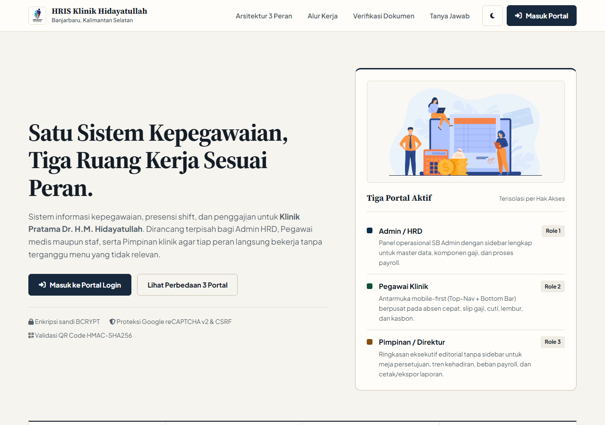
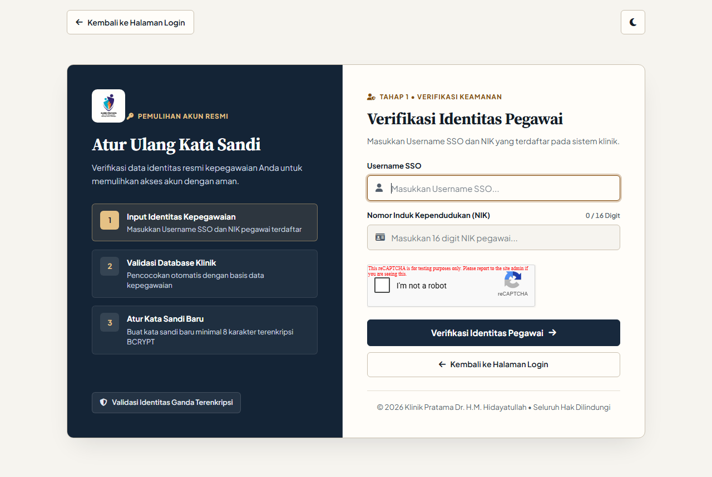

# Sistem Informasi Kepegawaian & Penggajian (HRIS)

### Klinik Pratama Dr. H.M. Hidayatullah (Banjarbaru)

[](https://github.com/NorisukiNZk/penggajian/actions/workflows/ci.yml)


Aplikasi web berbasis **CodeIgniter 3.1.11** untuk pengelolaan kepegawaian, presensi shift harian, cuti, lembur, pinjaman karyawan (kasbon), perhitungan penggajian (*payroll*), ekspor PDF resmi, serta verifikasi dokumen berbasis QR Code untuk **Klinik Pratama Dr. H.M. Hidayatullah**.

Proyek ini mengusung **Arsitektur Tiga Antarmuka Berbasis Peran (*Role-Differentiated UI/UX*)**: halaman kerja **Admin/HRD**, **Pegawai**, dan **Pimpinan/Direktur** memiliki kerangka layout, struktur navigasi, tipografi, dan karakter visual yang sesuai dengan alur kerja masing-masing peran (didokumentasikan lengkap pada [DESIGN.md](DESIGN.md)).

---

## Daftar Isi

- [Galeri Tampilan Aplikasi](#galeri-tampilan-aplikasi)
- [Arsitektur Antarmuka Berbasis Peran](#arsitektur-antarmuka-berbasis-peran)
- [Fitur Lengkap Sistem](#fitur-lengkap-sistem)
- [Pengerasan Keamanan & Rekayasa Backend](#pengerasan-keamanan--rekayasa-backend)
- [Teknologi & Pustaka](#teknologi--pustaka)
- [Struktur Direktori Proyek](#struktur-direktori-proyek)
- [Struktur Basis Data](#struktur-basis-data)
- [Pengujian Otomatis (PHPUnit)](#pengujian-otomatis-phpunit)
- [Prasyarat & Panduan Instalasi](#prasyarat--panduan-instalasi)
- [Kredensial Uji Coba & Daftar Rute](#kredensial-uji-coba--daftar-rute)

---

## Galeri Tampilan Aplikasi

| Halaman Depan (*Landing Page*) | Portal Masuk Single Sign-On |
| :---: | :---: |
|  |  |

| Pemulihan Kata Sandi (3 Tahap) | Verifikasi Dokumen QR (HMAC-SHA256) |
| :---: | :---: |
|  |  |

---

## Arsitektur Antarmuka Berbasis Peran

| Peran (`hak_akses`) | Gaya Antarmuka | Struktur Layout | Fokus Kerja Utama |
| :--- | :--- | :--- | :--- |
| **Admin / HRD** (`1`) | Panel Operasional Klinis (`template_admin`, `assets/css/admin-portal.css`) | Sidebar navy accordion + topbar utilitas & pemindah tema Light/Dark | Input master data, jam kerja & kuota cuti, proses komponen payroll, arsip PDF, dan monitoring audit log |
| **Pegawai** (`2`) | **Portal Mandiri Mobile-First** (`template_pegawai`, `assets/css/portal-pegawai.css`) | Top-Nav horizontal (desktop), drawer "Menu" (tablet), dan Bottom Bar (ponsel) | Presensi masuk/pulang real-time WITA, riwayat absensi, cuti/lembur/kasbon, filter tahun & unduh PDF slip gaji |
| **Pimpinan / Direktur** (`3`) | **Portal Eksekutif Editorial** (`template_pimpinan`, `assets/css/portal-pimpinan.css`) | Tanpa sidebar, masthead editorial + bar navigasi kategori di atas (`Source Serif 4` + `Plus Jakarta Sans`) | Ringkasan eksekutif, tren payroll & kehadiran 6 bulan, meja persetujuan dengan filter status & pratinjau berkas in-page, monitoring SDM, & ekspor laporan |
| **Publik & Autentikasi** (`landing_page`, `auth`) | Gerbang Editorial Klinis (`assets/css/landing-page.css`, `assets/css/auth-portal.css`) | Layout kertas klinis hangat (`#F6F4EF` / `#FFFDF9`) & Dark Mode (`#0F141B` / `#171F2A`) | Showcase 3 portal, verifikasi dokumen QR publik, Single Sign-On Login, pemulihan akun 3 tahap, dan halaman galat kustom |

---

## Fitur Lengkap Sistem

### 1. Gerbang Publik, Autentikasi & Verifikasi QR
- **Halaman Depan (*Landing Page*)** (`application/controllers/Landing_page.php`, `application/views/landing_page.php`):
  - Hero asimetris dengan indeks tiga portal aktif dan metrik basis data aktual (`data_pegawai`, `data_jabatan`).
  - *Showcase* interaktif 3 portal peran (tab pratinjau Admin, Pegawai, dan Pimpinan), ilustrasi `payroll.svg`, `administrator.svg`, dan `others-fitur.svg`, serta toggle Light & Dark Mode.
- **Single Sign-On & Pemulihan Akun Terpadu** (`Login.php`, `Lupa_password.php`, `assets/css/auth-portal.css`):
  - Autentikasi `PASSWORD_BCRYPT` + **Google reCAPTCHA v2** (sitekey/secret dikelola per lingkungan pada `application/config/app_security.php`).
  - Pembatasan percobaan login berbasis basis data (`login_attempts`, maks. 5 percobaan gagal lalu kunci 300 detik).
  - *Caps Lock detector*, regenerasi ID sesi saat login/ganti sandi, tombol cepat demo (hanya muncul bila `show_demo_chips = TRUE`), serta alur lupa password berbasis `username` + `nik` + kebijakan minimal 8 karakter.
- **Generator QR Murni PHP & Verifikasi Publik** (`application/libraries/Qr_matrix.php`, `application/helpers/qr_dokumen_helper.php`, `Verifikasi.php`):
  - Encoder ISO/IEC 18004 murni PHP (Byte mode, ECC Level M, Versi 1-10) yang merender langsung PNG *data URI* offline tanpa ketergantungan CDN JavaScript.
  - Verifikasi tanda tangan kriptografis **HMAC-SHA256** pada halaman publik `/verifikasi` untuk Slip Gaji, SK Cuti, SPPK Pinjaman, dan laporan klinik.

### 2. Portal Admin / HRD (`application/controllers/admin/`)
- **Dashboard Analitik & Audit** (`Dashboard.php`): Total pegawai aktif, status presensi harian, **Estimasi Payroll Bulan Ini**, **Grafik Tren Beban Penggajian 6 Bulan** (THP bersih, lembur, potongan), grafik tren kehadiran & komposisi jabatan, hari libur terdekat, antrean persetujuan HRD, serta **Audit Log Terbaru**.
- **Master Data & Operasional**:
  - `Data_pegawai.php`, `Data_jabatan.php`, `Hari_libur.php` (termasuk sinkronisasi hari libur nasional API berverifikasi sertifikat CA XAMPP).
  - `Absensi_harian.php`: Monitoring presensi harian, rekap bulanan pintar, penyesuaian status sakit/izin, sinkronisasi ke `data_kehadiran`, serta pengaturan jam kerja/lembur (`setting_absensi`). *(Rute warisan `Data_absensi.php` telah diarahkan otomatis ke `absensi_harian/rekap`).*
  - `Data_Cuti.php`, `Data_lembur.php`, `Pinjaman.php` (beserta pratinjau KTP/jaminan in-page & unduhan PDF SPPK/SK).
  - `Komponen_gaji.php`, `Potongan_gaji.php`, `Data_penggajian.php` (didukung `Payroll_calculator` & *batch component caching*).
- **Pusat Laporan & PDF Native** (`Laporan.php`, `Slip_gaji.php`, `Laporan_gaji.php`, `Laporan_Tahunan.php`, dan controller cetak lainnya):
  - Mendukung pratinjau cetak browser maupun pengunduhan langsung **PDF A4 native (Dompdf)** melalui `application/libraries/Pdf_exporter.php` dan template `application/views/pdf/` (`slip_gaji.php`, `daftar_gaji.php`, `sppk.php`, `surat_cuti.php`).
- **Log Aktivitas Audit** (`Log_aktivitas.php`): Pencatatan jejak audit login, persetujuan cuti/lembur/pinjaman, serta mutasi data master & payroll lengkap dengan filter modul dan pencarian kata kunci.

### 3. Portal Pegawai (`application/controllers/pegawai/`)
- **Beranda & Presensi** (`Dashboard.php`, `Absensi.php`): Absen masuk/pulang dengan jam server WITA via POST berproteksi CSRF, unggah foto profil mandiri (`update_foto`), ringkasan kehadiran, dan jadwal libur.
- **Layanan Mandiri** (`Cuti.php`, `Lembur.php`, `Pinjaman.php`, `Data_gaji.php`, `Ganti_Password.php`): Pengajuan cuti + delegasi shift, pembatalan aman via POST, simulator cicilan & DSR pinjaman, filter riwayat slip gaji berdasarkan tahun (`tahun`), cetak & unduh PDF slip gaji/SPPK/SK Cuti, dan pembaruan sandi minimal 8 karakter.

### 4. Portal Pimpinan (`application/controllers/pimpinan/`)
- **Ringkasan Eksekutif** (`Dashboard.php`): Komitmen payroll berjalan, tren penggajian & kehadiran 6 bulan, saldo kasbon berjalan, komposisi SDM, dan antrean persetujuan.
- **Meja Persetujuan Pimpinan** (`Persetujuan.php`): Tab terpisah (Cuti, Lembur, Pinjaman), **Filter Status** (`Semua Status`, `Menunggu Keputusan`, `Disetujui`, `Ditolak`), aksi mutasi wajib metode POST berproteksi CSRF, modal pratinjau lampiran in-page (`#modalExecPreview`), serta tombol cetak SK/SPPK & unduh PDF langsung.
- **Monitoring SDM & Pusat Laporan CSV/PDF** (`Monitoring.php`, `Laporan.php`): Ekspor **CSV UTF-8 BOM** bersanitasi *formula injection* (`Payroll_calculator::sanitizeCsvCell`), cetak laporan, dan unduh PDF daftar gaji.

---

## Pengerasan Keamanan & Rekayasa Backend

1. **Perlindungan CSRF Menyeluruh**: `$config['csrf_protection'] = TRUE` dengan `$config['csrf_exclude_uris'] = array()` kosong. Seluruh aksi mutasi negara (hapus data, setujui/tolak, absen masuk/pulang, pembatalan cuti) telah dikonversi dari tautan GET menjadi form `POST` ber-token CSRF.
2. **Keamanan Sesi, Cookie & Direktori Unggahan**:
   - Dukungan `CI_ENV` pada `index.php`, `encryption_key` berbasis env/config, `cookie_httponly = TRUE`, dan `cookie_secure` dinamis mengikuti HTTPS.
   - Proteksi `.htaccess` pada `uploads/` dan `photo/` untuk memblokir eksekusi skrip serta `Options -Indexes`.
3. **Pembatasan Laju Login & Audit Trail** (`ModelAudit.php`, `audit_log`, `login_attempts`):
   - Pencatatan upaya login gagal per username dan IP serta pencatatan seluruh aktivitas penting dengan penyamaran kata kunci sensitif (`[REDACTED]`).
4. **Pusat Logika Payroll & Eliminasi N+1 Query**:
   - Perhitungan gaji bersih, persentase/override komponen, dan pengurutan periode dipusatkan di `application/libraries/Payroll_calculator.php`.
   - `ModelKomponen::get_batch_komponen_bulan()`, `ModelAbsensiHarian::get_rekap_bulanan()`, dan `ModelPenggajian` mengeksekusi penarikan komponen & absensi secara *batch* per bulan dan memperbaiki pengurutan kronologis periode `MMYYYY`.
5. **Validasi Sertifikat SSL API Hari Libur**:
   - `admin/Hari_libur::sync_api()` memverifikasi sertifikat TLS menggunakan bundle CA (`curl-ca-bundle.crt`).

---

## Teknologi & Pustaka

- **Backend**: PHP `7.4` s/d `8.2`, **CodeIgniter 3.1.11** (`mysqli`), **Dompdf `^3.1`** (`composer.json`)
- **Database**: MySQL 5.7+ / MariaDB 10.x (**16 tabel**)
- **QR Code Engine**: Encoder murni PHP ISO/IEC 18004 (`application/libraries/Qr_matrix.php`) + GD PNG
- **Frontend & UI**:
  - Auth, Admin, Pegawai, Pimpinan & Landing Page: `assets/css/auth-portal.css`, `assets/css/admin-portal.css`, `assets/css/portal-pegawai.css`, `assets/css/portal-pimpinan.css`, `assets/css/landing-page.css`, Bootstrap 4.6 (`sb-admin-2.min.css` grid untuk Admin), jQuery
  - Tipografi: Google Fonts (`Plus Jakarta Sans` dan `Source Serif 4`)
  - Pustaka Visual & Tabel: FontAwesome `6.5.1`, Chart.js `4.4.7`, DataTables `2.2.2`, SweetAlert2 `11.17.2`
- **Testing & CI**: PHPUnit `5.2.7` (`phpunit.xml`, `tests/`) dan GitHub Actions (`.github/workflows/ci.yml`)

---

## Struktur Direktori Proyek

```text
penggajian/
├── .github/workflows/ci.yml            # Pipeline CI GitHub Actions (PHP lint + PHPUnit)
├── DESIGN.md                           # Dokumentasi arah desain, dial, palet WCAG AA, & struktur antarmuka
├── README.md
├── composer.json                       # Dependensi PHP (dompdf/dompdf, phpunit)
├── phpunit.xml                         # Konfigurasi suite uji unit
├── tests/
│   ├── bootstrap.php                   # Bootstrap test terisolasi + shim kompatibilitas timer PHPUnit 5
│   ├── PayrollCalculatorTest.php       # Uji perhitungan slip, komponen persentase/override, urutan periode, CSV
│   └── QrDokumenTest.php               # Uji HMAC-SHA256, QR encoder, dan dekoder piksel PNG ISO 18004
├── assets/
│   ├── css/
│   │   ├── admin-portal.css            # Stylesheet Admin Portal (Light & Dark Mode WCAG AA)
│   │   ├── auth-portal.css             # Stylesheet terpadu Login, Lupa Password, & Reset Password
│   │   ├── landing-page.css            # Stylesheet Landing Page & Verifikasi Dokumen
│   │   ├── portal-pegawai.css          # Stylesheet Portal Pegawai (Mobile-First Top-Nav + Bottom Bar)
│   │   ├── portal-pimpinan.css         # Stylesheet Portal Pimpinan (Editorial Zero-Sidebar)
│   │   └── sb-admin-2.min.css          # Grid Bootstrap dasar Portal Admin
│   ├── img/                            # Logo klinik (kpmh.png, kpmh.jpg) & ilustrasi SVG
│   ├── js/sb-admin-2.min.js            # Script navigasi dasar Admin
│   └── vendor/                         # jQuery, Bootstrap Bundle, & jQuery Easing (minified)
├── db database/
│   ├── penggajian.sql                  # Skema lengkap konsolidasi (16 tabel) & data dasar
│   └── migrations/                     # Arsip skrip migrasi bertahap (absensi, komponen, pimpinan, audit, password)
├── docs/
│   └── screenshots/                    # Tangkapan layar dokumentasi aplikasi untuk README GitHub
├── photo/                              # Foto profil pegawai (.htaccess terlindungi)
├── uploads/
│   ├── cuti/                           # Berkas lampiran pengajuan cuti / SKD (.htaccess terlindungi)
│   └── pinjaman/                       # Berkas KTP & dokumen jaminan pinjaman (.htaccess terlindungi)
└── application/
    ├── config/                         # autoload.php, app_security.php, config.php, database.php, routes.php
    ├── controllers/
    │   ├── Landing_page.php, Login.php, Lupa_password.php, Verifikasi.php, Ganti_Password.php
    │   ├── admin/                      # 23 controller operasional HRD, laporan, PDF, & Log_aktivitas
    │   ├── pegawai/                    # 7 controller layanan mandiri Pegawai
    │   └── pimpinan/                   # 5 controller eksekutif Pimpinan
    ├── helpers/
    │   └── qr_dokumen_helper.php       # Penandaan HMAC-SHA256 & penyematan QR PNG murni PHP
    ├── libraries/
    │   ├── Payroll_calculator.php      # Mesin hitung payroll murni & sanitasi CSV
    │   ├── Pdf_exporter.php            # Wrapper Dompdf untuk ekspor PDF A4
    │   └── Qr_matrix.php               # Generator QR ISO/IEC 18004 Byte mode murni PHP
    ├── models/
    │   ├── ModelAbsensiHarian.php
    │   ├── ModelAudit.php
    │   ├── ModelKomponen.php
    │   └── ModelPenggajian.php
    └── views/
        ├── landing_page.php, login.php, lupa_password.php, reset_password.php, verifikasi_dokumen.php
        ├── errors/html/                # Halaman error kustom Klinik Hidayatullah (404, DB, General)
        ├── pdf/                        # 4 template PDF Dompdf (slip_gaji, daftar_gaji, sppk, surat_cuti)
        ├── template_admin/, template_pegawai/, template_pimpinan/
        └── admin/, pegawai/, pimpinan/
```

---

## Struktur Basis Data

Database `penggajian` terdiri atas **16 tabel** (terkonsolidasi penuh di `db database/penggajian.sql`):

- **Kepegawaian & Akses**: `data_pegawai`, `data_jabatan`, `hak_akses` (`1 = admin`, `2 = pegawai`, `3 = pimpinan`)
- **Keamanan & Audit**: `audit_log`, `login_attempts`
- **Presensi & Kalender**: `absensi_harian`, `data_kehadiran`, `hari_libur`, `setting_absensi`
- **Cuti, Lembur & Pinjaman**: `data_cuti`, `setting_cuti`, `data_lembur`, `data_pinjaman`
- **Penggajian & Komponen**: `komponen_gaji`, `komponen_gaji_pegawai`, `potongan_gaji`

---

## Pengujian Otomatis (PHPUnit)

Jalankan seluruh uji unit dari root proyek:

```bash
php -d error_reporting=22527 vendor/phpunit/phpunit/phpunit
```

Cakupan uji saat ini meliputi:
- Perhitungan gaji bersih, pembatasan angka negatif (`max(0, net)`), persentase komponen vs nominal *override*, tarif potongan alpha, pengurutan kronologis periode `MMYYYY`, serta pencegahan *CSV formula injection* (`tests/PayrollCalculatorTest.php`).
- Pembangkitan dan verifikasi tanda tangan HMAC-SHA256, validasi struktur matriks QR ISO/IEC 18004, serta dekoding balik piksel gambar PNG QR Code lintas versi dan panjang payload (`tests/QrDokumenTest.php`).

---

## Prasyarat & Panduan Instalasi

### Prasyarat Sistem
- **Web Server**: Apache (XAMPP / Laragon) dengan `mod_rewrite` aktif
- **PHP**: Versi `7.4` s/d `8.2` dengan ekstensi `mysqli`, `curl`, `mbstring`, `json`, `dom`, dan `gd`/`fileinfo`
- **Database**: MySQL 5.7+ atau MariaDB 10.x

### Langkah Pemasangan
1. **Salin Proyek**: Letakkan folder ke root web server (misal `C:\xampp\htdocs\penggajian`).
2. **Pasang Dependensi Composer** (bila belum ada folder `vendor/`):
   ```bash
   # Lingkungan pengembangan (termasuk PHPUnit):
   composer install

   # Lingkungan produksi (tanpa paket dev/PHPUnit):
   composer install --no-dev --optimize-autoloader
   ```
3. **Siapkan Basis Data**:
   - Buat database bernama `penggajian` pada MySQL/phpMyAdmin.
   - Impor `db database/penggajian.sql` (skema lengkap konsolidasi 16 tabel). Untuk pembaruan dari basis data lama, arsip skrip migrasi bertahap tersedia di `db database/migrations/`.
4. **Konfigurasi Lingkungan & Keamanan**:
   - Pastikan kredensial pada `application/config/database.php` sesuai dengan server MySQL lokal.
   - Pastikan `$config['base_url']` pada `application/config/config.php` sesuai alamat instalasi, dan atur variabel lingkungan `APP_ENCRYPTION_KEY`, `CI_ENV`, `RECAPTCHA_SITE_KEY`, serta `RECAPTCHA_SECRET_KEY` di produksi pada `application/config/app_security.php` & `config.php`.
5. **Jalankan Aplikasi**: Buka `http://localhost/penggajian/` pada peramban.

---

## Kredensial Uji Coba & Daftar Rute

### Kredensial Demo Bawaan
Saat mode pengembangan aktif (`$config['show_demo_chips'] = TRUE`), akun berikut juga dapat diisi cepat di halaman login:

| Peran | Hak Akses | Username | Password | Rute Awal Setelah Login |
| :--- | :---: | :--- | :--- | :--- |
| **Admin / HRD** | `1` | `waffa` | `12345` | `admin/dashboard` |
| **Pegawai** | `2` | `anya` | `12345` | `pegawai/dashboard` |
| **Pimpinan / Direktur** | `3` | `pimpinan` | `pimpinan123` | `pimpinan/dashboard` |

> **Catatan Produksi**: Untuk server produksi/online, gunakan **PHP 8.1/8.2** (hindari PHP 7.4 EOL / XAMPP Windows di jaringan publik), pasang dependensi dengan `composer install --no-dev`, atur `CI_ENV=production`, serta tetapkan `APP_ENCRYPTION_KEY` dan kunci produksi reCAPTCHA v2. Root `.htaccess` sudah memblokir akses HTTP ke `/vendor/`, `/db database/`, `/tests/`, `/.git/`, `composer.json`, dan file `.sql`.

### Daftar Rute Utama
- **Publik**: `/`, `/login`, `/lupa_password`, `/verifikasi`, `/verifikasi/cek`
- **Admin**: `/admin/dashboard`, `/admin/log_aktivitas`, `/admin/data_pegawai`, `/admin/data_jabatan`, `/admin/hari_libur`, `/admin/absensi_harian`, `/admin/data_cuti`, `/admin/data_lembur`, `/admin/data_penggajian`, `/admin/pinjaman`, `/admin/komponen_gaji`, `/admin/laporan`
- **Pegawai**: `/pegawai/dashboard`, `/pegawai/absensi`, `/pegawai/absensi/riwayat`, `/pegawai/cuti`, `/pegawai/lembur`, `/pegawai/pinjaman`, `/pegawai/data_gaji`, `/pegawai/ganti_password`
- **Pimpinan**: `/pimpinan/dashboard`, `/pimpinan/persetujuan`, `/pimpinan/monitoring`, `/pimpinan/laporan`, `/pimpinan/ganti_password`

---

## Hak Cipta

Dikembangkan untuk operasional **Klinik Pratama Dr. H.M. Hidayatullah** (Jl. A. Yani KM 23 Liang Anggang, Banjarbaru, Kalimantan Selatan).

&copy; 2026 NorisukiNZk. Seluruh hak cipta dilindungi.
