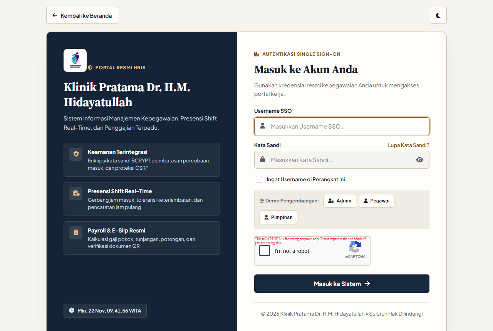
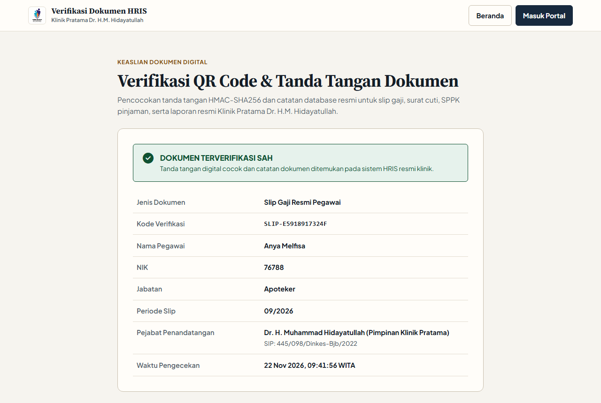

# HRIS & Penggajian Klinik Pratama Dr. H.M. Hidayatullah

[](https://github.com/NorisukiNZk/penggajian/actions/workflows/ci.yml)


Aplikasi web **CodeIgniter 3** untuk pengelolaan pegawai, absensi harian, cuti, lembur, pinjaman, penggajian (*payroll*), ekspor PDF A4, dan verifikasi dokumen QR Code. Antarmuka dipisah khusus untuk 3 peran: **Admin/HRD**, **Pegawai**, dan **Pimpinan**.

---

## Pratinjau Aplikasi

| Halaman Depan (*Landing Page*) | Portal Login Single Sign-On |
| :---: | :---: |
|  |  |

| Pemulihan Kata Sandi (3 Tahap) | Verifikasi Dokumen QR (HMAC-SHA256) |
| :---: | :---: |
|  |  |

---

## Fitur Utama

- **3 Portal Berbeda Peran**: Admin/HRD (backoffice operasional), Pegawai (mobile-first top-nav + bottom bar), dan Pimpinan (editorial eksekutif tanpa sidebar), lengkap dengan Light & Dark Mode.
- **Presensi & Aturan Libur Otomatis**: Absensi jam server WITA, otomatis tutup pada hari libur mingguan (default Sabtu & Minggu) dan tanggal merah nasional, tetapi terbuka khusus bila pegawai memiliki jadwal **Lembur Disetujui**.
- **Payroll & Penjelas Selisih Otomatis**: Hitung gaji pokok, tunjangan, lembur, potongan alpha/dinamis, dan cicilan kasbon, lengkap dengan penjelasan otomatis perubahan gaji bulan-ke-bulan di portal Pegawai, Admin, dan Pimpinan.
- **PDF Resmi & Verifikasi QR Offline**: Ekspor PDF A4 (Slip Gaji, Daftar Gaji, SK Cuti, SPPK) menggunakan Dompdf dengan QR Code murni PHP + tanda tangan HMAC-SHA256 yang dapat dicek publik di `/verifikasi`.
- **Keamanan Dasar Produksi**: Proteksi CSRF penuh (aksi mutasi wajib `POST`), login `bcrypt` + reCAPTCHA v2 + pembatasan percobaan login (`login_attempts`), audit log (`audit_log`), dan proteksi folder sensitif lewat `.htaccess`.

---

## Instalasi Cepat

**Prasyarat:** Apache (`mod_rewrite`), PHP `7.4` s/d `8.2` (`mysqli`, `curl`, `mbstring`, `dom`, `gd`), dan MySQL 5.7+ / MariaDB 10.x.

1. Letakkan proyek di root server web (misal `C:\xampp\htdocs\penggajian`).
2. Pasang dependensi jika folder `vendor/` belum ada:
   ```bash
   composer install
   ```
3. Buat database `penggajian` di MySQL/phpMyAdmin, lalu impor file `db database/penggajian.sql`.
4. Sesuaikan koneksi database di `application/config/database.php` dan URL di `application/config/config.php` (`$config['base_url']`).
5. Buka `http://localhost/penggajian/` di browser.

---

## Akun Demo & Rute Awal

| Peran | `hak_akses` | Username | Password | Halaman Awal |
| :--- | :---: | :--- | :--- | :--- |
| **Admin / HRD** | `1` | `waffa` | `12345` | `/admin/dashboard` |
| **Pegawai** | `2` | `anya` | `12345` | `/pegawai/dashboard` |
| **Pimpinan** | `3` | `pimpinan` | `pimpinan123` | `/pimpinan/dashboard` |

Rute publik: `/`, `/login`, `/lupa_password`, `/verifikasi`.

---

## Panduan Cepat Modifikasi

Gunakan peta berikut agar langsung menemukan file yang perlu diubah tanpa menelusuri seluruh folder:

| Yang Ingin Dimodifikasi | Lokasi File / Folder |
| :--- | :--- |
| Koneksi database & URL aplikasi | `application/config/database.php`, `application/config/config.php` |
| Kunci reCAPTCHA & tombol cepat demo login | `application/config/app_security.php` |
| Logo klinik, kop surat, & identitas instansi | `assets/img/kpmh.png`, `application/views/pdf/`, `application/views/landing_page.php` |
| Warna, font, & tema Light/Dark tiap portal | `assets/css/` (`admin-portal.css`, `portal-pegawai.css`, `portal-pimpinan.css`, `auth-portal.css`, `landing-page.css`) dan [DESIGN.md](DESIGN.md) |
| Halaman & logika per peran | `application/controllers/{admin,pegawai,pimpinan}/` dan `application/views/{admin,pegawai,pimpinan}/` |
| Header, navigasi, & footer tiap peran | `application/views/template_admin/`, `template_pegawai/`, `template_pimpinan/` |
| Rumus gaji & penjelas selisih otomatis | `application/libraries/Payroll_calculator.php`, `Payroll_diff_explainer.php`, `application/models/ModelPenggajian.php` |
| Aturan jam kerja, libur akhir pekan, & lembur | `application/libraries/Attendance_policy.php`, `application/models/ModelAbsensiHarian.php` |
| Template PDF & verifikasi QR Code | `application/views/pdf/`, `application/libraries/Pdf_exporter.php`, `Qr_matrix.php`, `application/helpers/qr_dokumen_helper.php` |
| Halaman error (404, DB, General) | `application/views/errors/html/` |
| Struktur database (16 tabel) | `db database/penggajian.sql` (skrip migrasi lama di `db database/migrations/`) |

> **Aturan penting saat menambah tombol aksi (hapus/setujui/tolak):** CSRF aktif global di semua rute. Gunakan form `POST` yang menyertakan token `$this->security->get_csrf_token_name()` dan `$this->security->get_csrf_hash()`, bukan tautan `GET`.

---

## Pengujian & Catatan Produksi

Jalankan seluruh unit test PHPUnit (21 test) dari root proyek:

```bash
php -d error_reporting=22527 vendor/phpunit/phpunit/phpunit
```

**Sebelum deploy ke server online:**
- Gunakan **PHP 8.1/8.2** dan jalankan `composer install --no-dev --optimize-autoloader`.
- Atur environment `CI_ENV=production`, `APP_ENCRYPTION_KEY`, serta kunci produksi `RECAPTCHA_SITE_KEY` & `RECAPTCHA_SECRET_KEY`.
- Root `.htaccess` sudah memblokir akses web ke `/vendor/`, `/tests/`, `/db database/`, `/.git/`, `composer.json`, dan file `.sql`.

---

&copy; 2026 NorisukiNZk · Klinik Pratama Dr. H.M. Hidayatullah, Banjarbaru.
